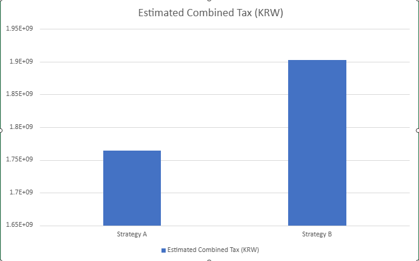

# Property Sale Strategy Comparison

## 1. Objective

This project compares two hypothetical property sale sequences in South Korea to examine how sale order and timing may affect capital gains tax and combined after-tax proceeds.

- **Strategy A:** Sell Hillstate in 2026, then Jungang Heights in 2027.
- **Strategy B:** Sell Jungang Heights in 2026, then Hillstate in 2027.

The calculator outputs are preliminary estimates and have not been independently verified.

## 2. Property Information

| Item | Hillstate | Jungang Heights |
|---|---:|---:|
| Acquisition Date | January 30, 2018 | September 16, 2008 |
| Acquisition Price | KRW 1,360,000,000 | KRW 370,000,000 |
| Assumed Sale Price | KRW 4,000,000,000 | KRW 2,750,000,000 |
| Assumed Deductible Expenses | KRW 10,000,000 | KRW 10,000,000 |
| Residence History | Never resided | Never resided |
| Ownership | Sole ownership | Sole ownership |
| Assumed Area Status | Regulated area | Regulated area |

## 3. Strategy A: Sell Hillstate First

### Step 1: Hillstate — 2026

| Item | Value |
|---|---:|
| Sale Price | KRW 4,000,000,000 |
| Acquisition Price | KRW 1,360,000,000 |
| Assumed Deductible Expenses | KRW 10,000,000 |
| Calculated Capital Gain | KRW 2,630,000,000 |
| Calculator-Estimated Total Tax | KRW 1,372,591,000 |

The calculator displays a tax rate of 45% plus an additional 5 percentage points under its selected tax settings.

### Step 2: Jungang Heights — 2027

| Item | Value |
|---|---:|
| Sale Price | KRW 2,750,000,000 |
| Acquisition Price | KRW 370,000,000 |
| Assumed Deductible Expenses | KRW 10,000,000 |
| Calculated Capital Gain | KRW 2,370,000,000 |
| Calculator-Estimated Total Tax | KRW 391,314,600 |

This estimate comes from the calculator screen showing a 30% long-term holding deduction and a 42% tax rate. The applicable treatment and eligibility have not been independently verified.

### Strategy A — Preliminary Total

| Metric | Amount |
|---|---:|
| Hillstate Estimated Tax | KRW 1,372,591,000 |
| Jungang Heights Estimated Tax | KRW 391,314,600 |
| **Combined Estimated Tax** | **KRW 1,763,905,600** |

## 4. Strategy B: Sell Jungang Heights First

### Step 1: Jungang Heights — 2026

| Item | Value |
|---|---:|
| Sale Price | KRW 2,750,000,000 |
| Acquisition Price | KRW 370,000,000 |
| Assumed Deductible Expenses | KRW 10,000,000 |
| Calculated Capital Gain | KRW 2,370,000,000 |
| Calculator-Estimated Total Tax | KRW 1,229,591,000 |

The calculator displays a multi-home surcharge-related tax treatment. The applicable treatment must be verified.

### Step 2: Hillstate — 2027

| Item | Value |
|---|---:|
| Sale Price | KRW 4,000,000,000 |
| Acquisition Price | KRW 1,360,000,000 |
| Assumed Deductible Expenses | KRW 10,000,000 |
| Calculated Capital Gain | KRW 2,630,000,000 |
| Calculator-Estimated Total Tax | KRW 673,490,400 |

This estimate is taken from the 2027 column of the calculator screen. The deduction and tax treatment must be verified for this scenario.

### Strategy B — Preliminary Total

| Metric | Amount |
|---|---:|
| Jungang Heights Estimated Tax | KRW 1,229,591,000 |
| Hillstate Estimated Tax | KRW 673,490,400 |
| **Combined Estimated Tax** | **KRW 1,903,081,400** |

## 5. Preliminary Strategy Comparison

| Item | Strategy A | Strategy B |
|---|---:|---:|
| First property sold in 2026 | Hillstate | Jungang Heights |
| Estimated tax on first sale | KRW 1,372,591,000 | KRW 1,229,591,000 |
| Second property sold in 2027 | Jungang Heights | Hillstate |
| Estimated tax on second sale | KRW 391,314,600 | KRW 673,490,400 |
| **Estimated combined tax** | **KRW 1,763,905,600** | **KRW 1,903,081,400** |

### Preliminary Findings

Based on the current tax calculator outputs and the assumptions used in this analysis, Strategy A has an estimated combined capital gains tax of KRW 1,763,905,600, compared with KRW 1,903,081,400 under Strategy B.

Strategy A therefore shows an estimated tax advantage of KRW 139,175,800.

This finding is based on calculator estimates and the stated scenario assumptions. Actual tax liability may differ depending on the tax rules applicable to each sale date and the taxpayer's eligibility for relevant deductions or exemptions.

### Visual Comparison

*Note: These figures are preliminary tax calculator estimates and have not been independently verified.*

## 6. Limitations

- Sale prices and deductible expenses are assumptions.
- Both properties are assumed to be in designated regulated areas.
- The owner is assumed never to have resided in either property.
- Tax treatment may change after the first property is sold.
- Eligibility for deductions, exemptions, and multi-home surcharge treatment has not been independently verified.
- The estimates do not establish which strategy is legally or financially preferable.
- Combined after-tax proceeds have not yet been fully calculated.

## 7. Next Steps

1. Verify the calculator assumptions for each sale.
2. Confirm which deductions and tax rates apply in 2026 and 2027.
3. Recalculate both strategies using consistent assumptions.
4. Compare verified estimated tax and combined after-tax proceeds.
5. Update the conclusion when the analysis is complete.

## Conclusion

Based on the current estimates, Strategy A results in a lower combined capital gains tax than Strategy B by KRW 139,175,800.

This analysis demonstrates how the order and timing of property sales can affect estimated tax outcomes.

Before making an actual sale decision, the applicable tax treatment, deductions, and eligibility requirements should be verified for each sale date.

## Disclaimer

This project is for educational and portfolio purposes only. It does not constitute professional tax, legal, or financial advice.
